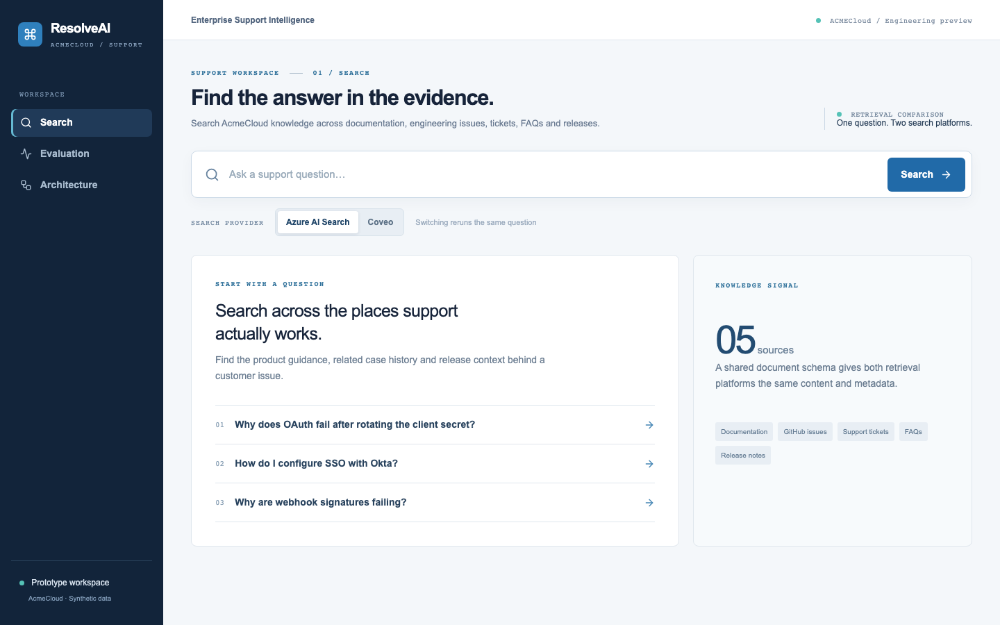

# ResolveAI

[](https://github.com/ankitluthra/ResolveAI/actions/workflows/ci.yml)

ResolveAI is an enterprise support intelligence prototype for investigating technical cases across fragmented knowledge. It brings documentation, issues, tickets, FAQs, and release notes into one searchable workspace so a support engineer can find evidence and trace a resolution. Coveo and Azure AI Search are the retrieval implementations; the same corpus and questions make their behavior measurable.

## Customer problem

AcmeCloud, a fictional developer platform, answers support questions using scattered docs, FAQs, GitHub issues, tickets, and release notes. A question about OAuth secret rotation may require several of these sources. ResolveAI focuses on retrieval, access boundaries, grounded answers, and measurable latency.

## Solution

A reproducible connector and normalizer produce 250 synthetic records across five source types. The same canonical corpus is prepared for Azure AI Search and a Coveo Push source. FastAPI presents a shared `SearchProvider` contract to a Next.js support workspace, evaluation runner, and optional grounded answer layer. Live indexing and comparison are the next verification milestone.

The **Case Evidence Trail** connects three curated customer cases to engineering findings, releases, and maintained procedures. Each link cites an excerpt in a source record. The case view works locally without credentials and can query Coveo or Azure to check which linked records the provider actually returns. Provider verification still needs live indexing.

## Demo

1. Open the Search workspace and ask: **Why does OAuth fail after rotating the client secret?**
2. Inspect results, filters, and retrieval diagnostics.
3. Switch providers; the URL preserves the query.
4. Generate an answer and open a cited local source record (requires OpenAI credentials).
5. Review recorded Hit@1, Hit@3, MRR, latency, and query-level rankings on Evaluation.
6. Open Cases to follow a ticket-to-resolution path and inspect the evidence behind each connection. Select Coveo or Azure on the case page after live indexing to check retrieved records.



The welcome and architecture pages work without credentials; live search and measured scores require configured services.

## Architecture

```text
Five source types → Normalize → KnowledgeDocument
                                  ↙         ↘
                         Azure AI Search   Coveo
                                  ↘         ↙
                          SearchProvider contract
                          ↙         ↓         ↘
                    Search UI   Evaluation   Grounded answer
```

The provider adapters translate each platform's query and result shape behind one API contract.

## Features

- Unified search and filters for source, product, category, update date, and visibility.
- Isolated Azure AI Search and Coveo adapters, server-side credentials, and URL-backed provider switching.
- Clickable source records and retrieval diagnostics.
- Grounded OpenAI response with validated source IDs and insufficient-evidence fallback.
- A fixed 25-question dataset and live evaluation runner.
- Three connected support cases with sourced links, case-ID retrieval, and six fixed multi-document evaluation questions.

## Evaluation

The dashboard intentionally shows **no benchmark numbers** until the live runner succeeds. The 25-question retrieval set includes core support questions and harder source-specific cases. The evaluation script records Hit@1, Hit@3, MRR, average latency, and every returned document ID. An eight-case answer set checks supported questions, abstention, and citations; factual accuracy still requires manual review.

The case evaluation measures how much of each expected evidence set appears in ordinary top-10 search results, then checks case-filtered retrieval and whether complete evidence paths are present. It records corpus, case-definition, and question-set fingerprints. The case filter assumes the user has opened the right case; it does not measure automatic case identification or human time to resolution.

## Engineering decisions

Canonical normalization preserves stable IDs across providers. Provider-specific HTTP calls remain at the boundary. The answer layer receives retrieved excerpts only. The fixed relevance set precedes tuning.

## Running locally

Requires Python 3.11+, Node 20+, `uv`, and credentials for each live integration.

The commands below cover local setup and live indexing. Check field mappings and searchable counts in each provider's console before running evaluations.

```bash
cp .env.example .env
uv sync --project apps/api --extra dev
npm install --prefix apps/web
apps/api/.venv/bin/python -m scripts.seed_data
```

Edit `.env` at the repository root. For the web app, place `NEXT_PUBLIC_API_URL=http://localhost:8000` in `apps/web/.env.local`.

### Azure AI Search

Create an Azure AI Search service and obtain its endpoint and admin key. Set `AZURE_SEARCH_ENDPOINT`, `AZURE_SEARCH_API_KEY`, and `AZURE_SEARCH_INDEX`. From the repository root, run:

```bash
apps/api/.venv/bin/python -m scripts.sync_azure
```

This creates the index and uploads the normalized corpus. The service uses the `2024-07-01` [Azure AI Search REST API](https://learn.microsoft.com/en-us/rest/api/searchservice/). The demo runs keyword search; semantic/hybrid ranking is reserved for a measured experiment on a supported tier.

### Coveo

Create a trial organization and a **public [Push source](https://docs.coveo.com/en/1546/) named `ResolveAI Knowledge`**.

Use two [API keys](https://docs.coveo.com/en/1718/), so the key the web API uses for queries can't change the index:

- `COVEO_API_KEY`: [Push API](https://docs.coveo.com/en/78) access to the source, plus the [Fields privilege](https://docs.coveo.com/en/1707) (view, create, edit) for field setup. Used only by the scripts.
- `COVEO_SEARCH_API_KEY`: [Search API](https://docs.coveo.com/en/1445/) access only. Used by the API server. If it's empty, `COVEO_API_KEY` is used for search too.

Set `COVEO_ORG_ID`, `COVEO_SOURCE_ID` and both keys. Outside the US region, also set the region-specific `COVEO_PUSH_BASE_URL` (for example `https://api-eu.cloud.coveo.com`), `COVEO_PLATFORM_BASE_URL` (for example `https://platform-eu.cloud.coveo.com`) and, if necessary, `COVEO_SEARCH_ENDPOINT`.

Create the `ra_*` custom fields through the Field API. The script lists the organization's fields, creates only the missing ones, and warns (without changing anything) when an existing field has a different type or options:

```bash
apps/api/.venv/bin/python -m scripts.setup_coveo_fields --dry-run
apps/api/.venv/bin/python -m scripts.setup_coveo_fields
```

| Field | Type | Options |
| --- | --- | --- |
| `ra_case_id`, `ra_source_type`, `ra_product`, `ra_category`, `ra_visibility` | String | Facet, Search operator, Displayable in results |
| `ra_tags` | String | Multi-value facet (sent as a list), Search operator, Displayable in results |
| `ra_updated_at` | Date | Facet, Sortable, Search operator, Displayable in results |
| `ra_id` | String | Search operator, Displayable in results |

Search operator is what lets the `@ra_case_id=="..."` style filters work. Push source automapping fills fields whose names match the document metadata. Then push the corpus:

```bash
apps/api/.venv/bin/python -m scripts.sync_coveo
```

The sync sends one Push API request per document. Throttled (HTTP 429) and transient 5xx responses are retried with exponential backoff and full jitter, using the same defaults as Coveo's official [push-api-client.js](https://github.com/coveo/push-api-client.js): up to 10 attempts, starting at 5 seconds and doubling. A `Retry-After` header, when present, sets the wait instead. One wait is capped at 60 seconds; change it with `COVEO_RETRY_MAX_DELAY_MS` (and the other `COVEO_RETRY_*` / `COVEO_MAX_ATTEMPTS` settings). Search requests are not retried.

Use public source settings only for this synthetic corpus. Indexing is asynchronous, so wait until the source shows 250 searchable items before evaluating.

### API, UI, and evaluation

```bash
apps/api/.venv/bin/uvicorn apps.api.app.main:app --reload --port 8000
npm run dev --prefix apps/web
```

Open `http://localhost:3000`. Run evaluation after each index is searchable:

```bash
curl -X POST 'http://localhost:8000/api/evaluations/run?provider=azure'
curl -X POST 'http://localhost:8000/api/evaluations/run?provider=coveo'
```

After the same corpus is searchable in both providers, run the case evidence check:

```bash
apps/api/.venv/bin/python -m scripts.run_case_evaluation --provider azure
apps/api/.venv/bin/python -m scripts.run_case_evaluation --provider coveo
```

Optional grounded answers require `OPENAI_API_KEY` in the root `.env`. Run `apps/api/.venv/bin/pytest -q apps/api/tests` and `npm run build --prefix apps/web` for local checks.

## Project structure

`apps/api` contains the FastAPI endpoints and provider adapters. `apps/web` contains the Next.js workspace. `ingestion` owns connector and normalization code. `data/synthetic` is source input; `data/normalized` is the generated canonical corpus. `evals` contains the fixed relevance set and measured run output. `scripts` contains repeatable CLI commands.

## Limitations

The records are fictional and templated. Their source URLs use a reserved example domain; the workspace opens a local source view instead. No live provider indexing, benchmark result, or OpenAI answer can be claimed until credentials and platform configuration are supplied. Visibility is demonstrative metadata, **not access control**. Coveo field mapping and incremental delete behavior must be verified in the configured trial.

## Production evolution

Add identity, enforceable provider permissions, real connectors, PII controls, retries, audit logs, observability, tenant isolation, and a larger customer-reviewed evaluation set.
